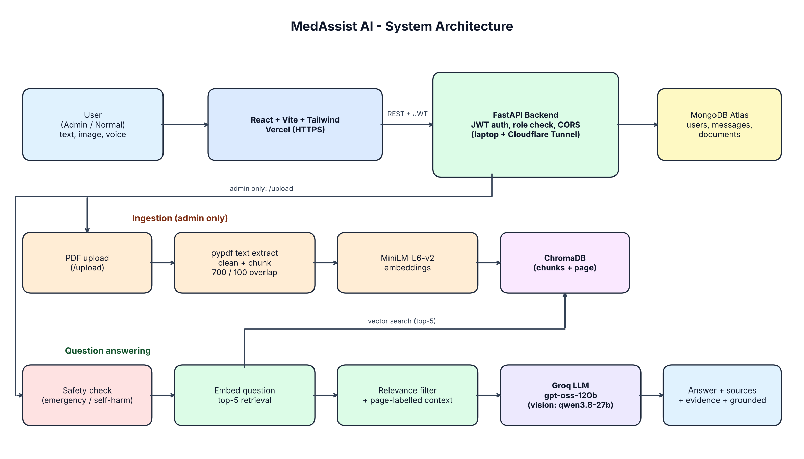

# MedAssist AI

AI-powered medical question answering using Retrieval-Augmented Generation (RAG), with a ChatGPT-style interface, evidence-backed answers, admin document management, and multimodal input.

> Educational use only. MedAssist AI shares general medical information and is not a substitute for professional medical advice. In an emergency, call your local emergency number (112 in India).

**Live demo:** https://medassistai-app.vercel.app (frontend; the backend runs behind a temporary Cloudflare tunnel during demos)

## Features
- Chat with medical questions answered from uploaded PDFs plus general medical knowledge, with sources labeled
- Evidence view: document, page number and supporting passage for every grounded answer; a notice appears when no supporting passage was found
- Admin-only PDF upload and document management (status, pages, chunks, upload date, verified delete)
- Image questions (JPG/PNG/WEBP, up to 4 MB), voice input (speech-to-text) and voice output (text-to-speech)
- Chat history, bookmarks, PDF/DOCX export
- JWT authentication with role-based access (admin / user)
- Medical safety layer: emergency and self-harm detection with local helplines, scope rules in the system prompt, standing disclaimer

## Architecture

```
React + Vite + Tailwind (Vercel)
        |  HTTPS + JWT
FastAPI backend ---- MongoDB Atlas (users, messages, documents)
   |-- pypdf -> clean -> chunks (700 chars, 100 overlap) with page metadata
   |-- all-MiniLM-L6-v2 embeddings -> ChromaDB (persistent)
   |-- retrieval: top-5 -> relevance selection -> context with page labels
   `-- Groq LLM (openai/gpt-oss-120b); vision: qwen/qwen3.8-27b
```

## Tech stack
| Layer | Technology |
|---|---|
| Frontend | React, Vite, Tailwind CSS |
| Backend | FastAPI, Uvicorn |
| Auth | JWT (HS256), bcrypt |
| Database | MongoDB Atlas |
| Vector store | ChromaDB |
| Embeddings | sentence-transformers all-MiniLM-L6-v2 |
| LLM | Groq API |
| Deployment | Vercel (frontend), local FastAPI + Cloudflare Tunnel (backend) |

## Project structure
```
MedAssistAI/
  backend/
    main.py              # API routes, auth, CORS
    services/            # pdf_processor, vector_store, llm_service, vision_service, document_service
    test_full.py         # pytest suite (25 tests)
    eval_rag.py          # RAG evaluation script
    requirements.txt, Dockerfile, Procfile
  frontend/
    src/                 # Dashboard, Admin, ChatMessage, api.js
    vercel.json
```

## Run locally
Backend:
```powershell
cd backend
python -m venv venv
.\venv\Scripts\Activate.ps1
pip install -r requirements.txt
# create backend/.env with: GROQ_API_KEY, MONGO_URI, JWT_SECRET_KEY
uvicorn main:app --reload --port 8000
```
Frontend:
```powershell
cd frontend
npm install
# create frontend/.env with: VITE_API_URL=http://localhost:8000
npm run dev
```

## Environment variables
| Variable | Where | Purpose |
|---|---|---|
| GROQ_API_KEY | backend | LLM access |
| MONGO_URI | backend | MongoDB Atlas connection |
| JWT_SECRET_KEY | backend | Token signing |
| ALLOWED_ORIGINS | backend | Comma-separated allowed frontend origins (CORS) |
| CHROMA_PATH | backend | ChromaDB folder (default `chroma_db`) |
| VITE_API_URL | frontend | Backend base URL (no secrets) |

Never commit `.env` files.

## Testing

The project includes 25 automated tests covering API endpoints,
authentication, chat functionality, history, bookmarks, feedback,
and export features.

Test results: 25 passed, 0 failed.

Command:
pytest -q
## Known limitations
- The Groq free tier has rate limits (tokens per minute).
- The demo backend depends on the presenter's computer and a temporary tunnel URL.
- Evidence cards are not saved to chat history.
- Not a medical device; answers must not be used for diagnosis or treatment.

## Author
Saripudi Jaya Lakshmi, B.Tech CSE, VIT-AP University (capstone project).
